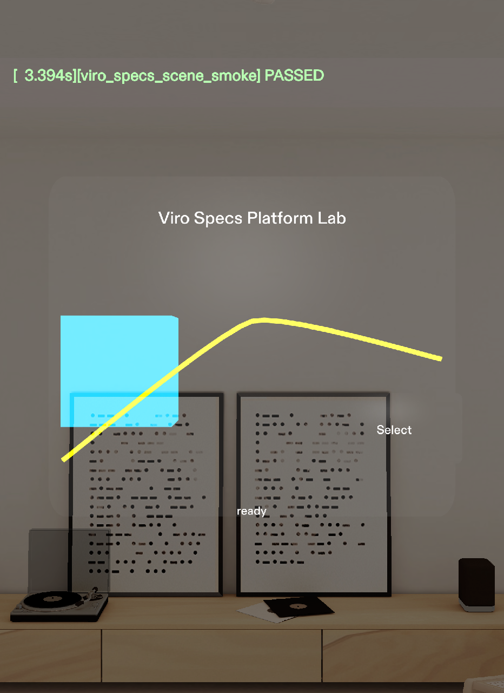

# Platform Lab validation evidence — October 2, 2026

- [Preview screenshot](./preview.png): independently inspected final smoke PASS, visible title/model/Select/status and local polyline.
- [Results](./results.json): final post-sync LEAF log excerpts, intentional failing assertion, actual coordinate-driven SIK drag, preserved metadata count, and fingerprints of all 19 runtime files.
- [Performance SQL summary](./performance-deep.json): bounded queries from the repeat interaction trace. Values are recorded section durations, not whole-frame pacing or device FPS.
- [Full validation report](../../CLADValidationReport.md): implementation changes, test scope, simulator/tool limitations, performance interpretation and exact hardware-only matrix.

The saved Lens project and raw traces remain on the validation Mac at the locations recorded in the report. This export includes focused test evidence; it excludes MCP credentials and raw editor telemetry.

